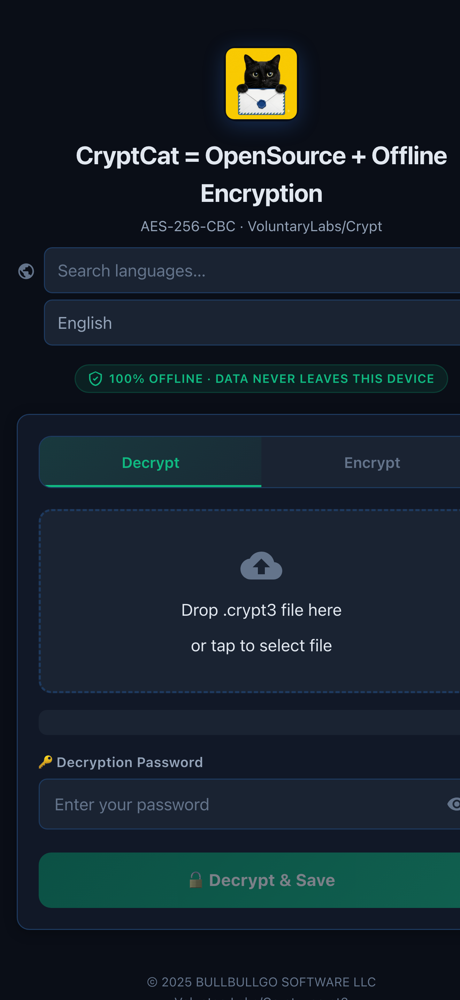
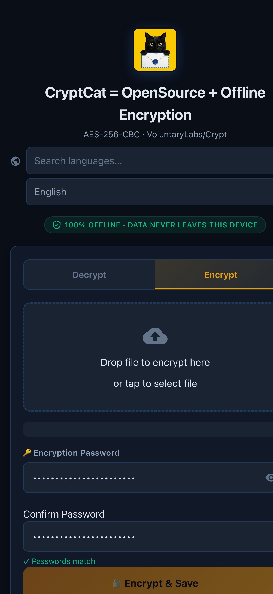
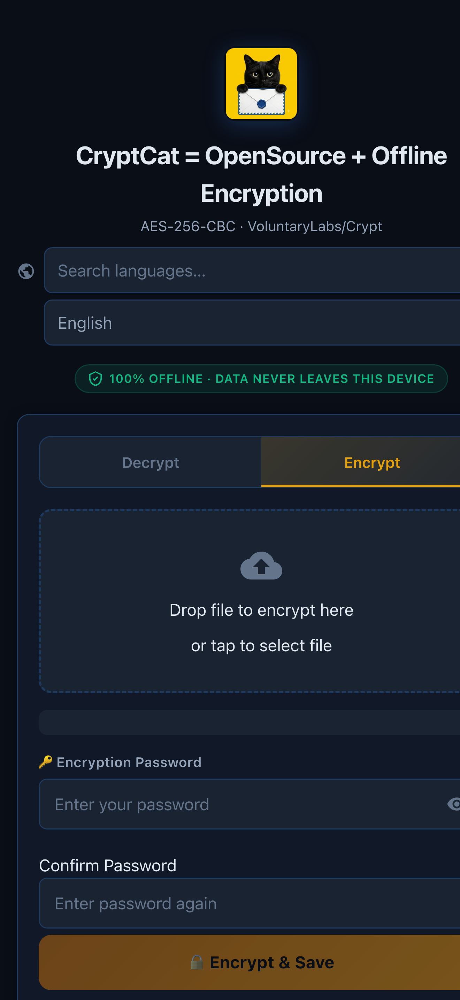

# Guia visual passo a passo do CryptCat

Este guia explica a versão Web. Os arquivos e as senhas são processados no seu dispositivo. O uso normal não precisa de conta nem de Internet.

## Criptografar um arquivo

### Passo 1: escolher um arquivo

Abra a página e clique em **Escolher arquivo**. Selecione uma foto, vídeo, áudio, PDF, TXT, ZIP ou outro arquivo. O nome e o tamanho serão mostrados.

### Passo 2: digitar e confirmar a senha

Digite uma senha em **Senha de criptografia** e repita-a em **Confirmar senha**. Continue somente quando as duas senhas forem iguais.

### Passo 3: criptografar e salvar

Clique em **Criptografar e salvar**. O navegador salvará um arquivo novo com final `.cryptcat`. Não feche nem atualize a página durante o salvamento.

## Descriptografar um arquivo

### Passo 4: escolher o arquivo criptografado

Abra **Descriptografar**, clique em **Escolher arquivo criptografado** e selecione o `.cryptcat`. Arquivos antigos `.crypt3` também são reconhecidos automaticamente.

### Passo 5: digitar a senha de descriptografia

Digite a senha original em **Senha de descriptografia**. Uma senha errada deve falhar e não deve produzir um arquivo recuperado.

### Passo 6: descriptografar e salvar

Clique em **Descriptografar e salvar**. Abra o arquivo restaurado e confira o conteúdo antes de apagar qualquer cópia.

## Segurança e uso offline

Se perder a senha, o CryptCat não pode recuperar o arquivo. Não publique senhas, chaves de API, chaves de assinatura ou arquivos privados. Para testar o modo offline, desligue a Internet e repita os seis passos.
